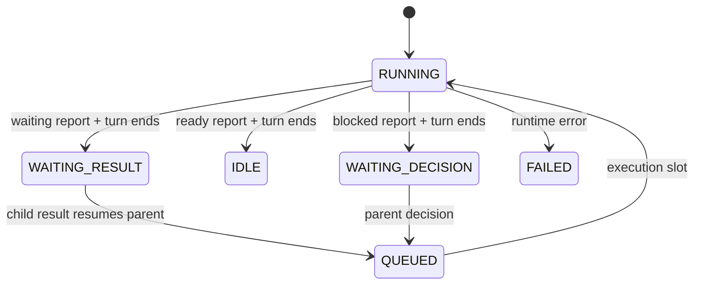

# Subagents V2：技能激活的 Multitask

## 目标与交付边界

通过 `/skill:multitask <任务>` 显式选择任务树的并行工作策略。root 和获授权的每层 child 都可以在本任务内拆分独立工作；派发后继续本地工作；没有可推进工作时结束 turn，释放执行槽，由结果事件恢复。保留 Pi AgentSession、V2 team 工具与 Grok 原生 Tasks/child view 的所有权。

本次 P0 交付技能、内置发现/打包、语义 waiting report、定向回归。P1 是本文给出的后续硬化设计，尚未实现。技能提供模型工作协议，不等于资源隔离、硬预算或用户输入队列调度器。

## 目录

1. 调研事实与来源
2. 当前源码事实与差距
3. 激活与策略边界
4. 非阻塞生命周期
5. 调度、依赖与写入
6. 后续运行时接口
7. 验收、风险与进度

## 调研事实与来源

核对日期：2026-11-02。只将一手文档作为行为依据，不推测闭源调度器源码。

| 来源 | 已确认行为 | 对本项目的启发 |
|---|---|---|
| Cursor 3.2，2026-04-24 [Multitask](https://cursor.com/changelog/04-24-26) | `/multitask` 使用 async subagents 并行处理请求，也可拆分大任务；已有排队消息可转为 multitask | 将“新请求总是排队”和“主动拆分并行”区别开；本次先覆盖后者 |
| Cursor 3.3，2026-05-07 [Build in Parallel](https://cursor.com/changelog/05-07-26) | 独立计划步骤并行，依赖步骤保持顺序；编辑器也提供 `/multitask` | 依赖就绪后才启动消费者，不把整个计划同时启动 |
| [Cursor Subagents](https://cursor.com/docs/subagents) | 独立上下文；background 立即返回；可恢复身份；支持有界嵌套；默认共享 checkout，也支持隔离工作副本 | 复用 V2 稳定路径和会话；不要把共享 cwd 当成 worktree 隔离 |
| [OpenCode V2 Tools](https://dev.opencode.ai/v2/docs/tools)、[Agents](https://dev.opencode.ai/v2/docs/agents/) | `background: true` 立即返回、完成通知 parent；`sessionID` 续跑；默认一层嵌套；配置控制可启动的 child | 任务句柄、事件回传、深度限制属于 runtime；技能只选择如何使用 |
| [Claude Code Subagents](https://code.claude.com/docs/en/sub-agents) | 前台/后台分开；可配置技能预加载与嵌套深度；不同运行界面和 fork 配置下，嵌套等待规则不同 | 不照抄“启动 background 就不会占父槽”的假设；检查真实生命周期 |
| [Agent Skills specification](https://agentskills.io/specification) | `SKILL.md` 的 name/description 用于发现；正文按需加载；技能不是线程或进程 API | 使用标准技能入口，执行仍由 V2 runtime 负责 |

截图能够确认菜单文案 “Multitask — Orchestrate multiple subagents in parallel” 和 OpenCode 模型标签，不能确认截图来自哪个版本或产品；Cursor 的对应行为由上述官方 changelog 独立确认。

### 建议采用的产品语义

- Multitask 是同一任务树内的工作策略，每个 Agent 都可同时承担 coordinator 与 worker 职责。
- “每个 Agent 采用该机制”不意味着每个 Agent 必须创建更多 Agent。没有收益、预算不足或已达深度的叶子直接执行。
- 非阻塞指派发调用不等待任务完成、协调者不靠长 tool wait 占槽；初始化资源仍有开销。
- 新用户请求在忙碌时能否插队/转为并行，是输入路由功能，P0 不声明已经支持 Cursor 的队列转换体验。

现有 child 是同一个 Pi 进程内的独立 AgentSession，并非每个 Agent 一个 OS 进程。这里的非阻塞首先指 root 不等待 child 完成、协调者不占执行槽等下级；它不提供 CPU 或进程故障隔离。避免在 coordinator 中增加同步重运算；耗时辅助计算应走现有命令工具。若将来需要进程级强终止/资源配额，应单独设计 worker-process 边界并验证消息协议。

## 当前源码事实与差距

基线：检查时 HEAD 为 `16f43c85`，工作区存在其他开发中的修改，变更限定于本功能文件。

| 位置 | 当前机制 | 判断 |
|---|---|---|
| `extensions/pi-grok-subagents/index.ts` | `resources_discover.skillPaths` 暴露 proactive skill；V1/V2 互斥注册 | 增加 V2 专用 multitask skill；发现不自动激活 |
| `v2.ts: spawnAgent / spawnTeamTool` | child `background: true`；单 child 异步；preset 默认 timeout=0，但显式正 timeout 可等待 | 复用，技能禁止传正 timeout |
| `v2.ts: deliverFinalAnswer / reactivateAgent` | idle parent 复用 child session 新建 run record；queued parent 缓存消息；running parent 接收 followUp | 已具备逐层结果唤醒，不需要新 agent loop |
| `v2.ts: team_wait` | root 可按 `timeout_ms` 等待选定的 team；child 无匹配 active peer 时立即返回 | child 长等仍在 `session.prompt()` 内，占共享执行槽 |
| `runtime.ts: scheduleBackgroundTask`、`shared.ts` | 整棵树共用 4 个后台执行槽，run 的 Promise 结束才释放 | 4 个 coordinator 同时等 queued child 会饥饿至 timeout；不是无限死锁，但会显著停顿 |
| `runtime.ts: createRecord` | child `noExtensions/noSkills/noContextFiles`，仅 agent definition 显式资源；systemPromptOverride | root 读技能不等于 child 读技能；不能关闭资源隔离来传播模式 |
| `skills/multi-agent-proactive/SKILL.md` | Proactive/Ultra 仅 parent 主动；child 进一步拆分需明确任务授权 | 独立新技能，任务书明确授权；不重写默认继承规则 |
| Rust `subagent_extension.rs` | 内嵌 TS 和技能到临时目录 | 新技能必须同步打包，否则源码可用而发布产物缺文件 |

## 激活与策略边界

### P0：文档协议，显式任务树作用域

1. 同时启用 Pi subagents 与 V2 后，通过官方 `resources_discover` 发现 `multitask`。
2. 用户输入 `/skill:multitask <任务>`；Pi 的 `AgentSession._expandSkillCommand()` 展开技能正文。
3. root 只对本次任务启用策略，并给每个 child 的自包含任务书附带精简 Multitask 契约。
4. child 再派发时复制契约，并减少剩余深度/分配额度。这是任务显式授权，不是继承父 extensions/skills。
5. 用户“单 Agent/不并行/不要进一步拆分”的指令立即限制后续派发。已运行工作先核对状态，再明确处置，不暗中扩大范围。
6. V1 不发现该技能；V2 缺失时不模拟工具、不自动切换配置。
7. P0 没有隐藏 session-wide 开关。后续无关用户任务不应因历史读过技能而默认递归并行。

技能中的深度/配额是软约定。模型可能不遵守；不把文案称为 runtime 保证，也不从普通聊天文本猜测硬权限。

### 与现有模式的关系

| 方式 | root 主动拆分 | child 主动拆分 | 资源发现 |
|---|---:|---:|---|
| 普通 V2 | 按任务授权 | 只在任务明确要求时 | 当前默认 |
| Proactive / Ultra | 可以，按收益判断 | 不自动继承 | 原 skill 不变 |
| `/skill:multitask` | 可以 | 任务书明确授权且有剩余额度时可以 | V2 专用 skill；child 仍隔离 |
| 用户明确单 Agent | 不创建 | 不创建 | 不扩大权限 |

## 非阻塞生命周期

`Agent identity`、`run record`、`任务交付完成`是不同概念。一个 Pi prompt run 结束只是本轮执行结束；协调任务仍可能等待下级。

### P0 增加 report=waiting

新增 `team_report(state="waiting", summary="...")`，用于 child 已派发自己的下级、暂时没有独立工作可做的汇合点。

- 仅允许存在本 Agent 自己的 running/queued/WAITING_RESULT child 时声明，不能等待无关 peer、把待决问题留给下级或编造依赖。
- 工具只记录语义，Agent 仍须结束当前 turn；report 工具返回本身不释放槽。
- 本轮成功结束后，coordinator 显示 `WAITING_RESULT`，不向上发送中间 FINAL_ANSWER。
- 槽在本轮 prompt Promise 结束后由共享 runtime 释放，下级因此能够执行。
- 下级 FINAL_ANSWER 到达时，复用原 parent session，创建新 run 并清除上一轮 report，再执行验收/汇总。
- 本轮运行异常、取消必须向上报告，不让旧 waiting/dropped 吞掉失败。
- child 的 dropped 若碰到已声明 waiting 的 parent，仍作为依赖完成事件恢复 parent；其他 dropped 保留原有静默语义。
- `blocked` 专用于需要父级决定且 question 必填；`dropped` 专用于真正无需父级行动，不用于掩盖未完成依赖。
- root 没有 parent，不调用 team_report；无独立工作时结束当前 turn，等待正常 followUp 唤醒。



WAITING_RESULT 是协调层状态；持久 run record 仍为 completed。P0 不新增 Pi session 格式，也不把协调状态伪装成一个仍在执行的 run。

### 典型过程

1. root 启动 `/root/backend`、`/root/frontend`，继续处理集成契约。
2. backend 有独立的 schema 调查，创建 `/root/backend/schema`，自己实现不依赖 schema 的部分。
3. backend 到真正依赖点，report waiting 并结束 turn。frontend 可以执行，schema 也能获得槽。
4. schema 完成，结果恢复 backend；backend 验证后 report ready。
5. root 根据 backend/frontend 的交付证据完成集成与验证。所有必需交付完成前不向用户宣称整项完成。

## 调度、依赖与写入

### P0 默认软预算

- root 深度记 0，最多两层 child（root → coordinator → worker）。
- root 为整次任务分配最多 8 个新 agent identity；保留自己及预留份额后，向各 child 分配互不重叠的剩余额度。额度不足直接本地执行。
- 每个 coordinator 通常最多 2 个直系 child，未就绪的消费者暂不启动。
- 全树实际后台并发仍由已有 runtime 限制为 4；不把它解释成“每个父级各 4 个”。
- 不按成本假设自动降级模型；遵守 agent definition 的 model/capability/turn 配置和用户约束。现有 max_turns 是软提醒，不是预算硬停止。
- 有路径的 agent 优先 follow-up 复用；同一目标不重复 spawn。

### DAG 的最小表达

P0 在任务书列出 task id、depends_on、owner、write_scope、验收命令；这只是文本契约，不伪装成已有工具字段。

只有依赖结果已验收的任务才派发。避免把 synthesizer 与生产者一起启动后长期 wait；预设团队含这类成员时，先用 members 子集启动生产者，结果到达后另行派发消费者并提供证据。

### 共享 cwd 写域

V2 未提供 per-agent workdir 参数。所有 child 共享 cwd，必须按文件/模块分配单一 writer；重叠修改串行化，审查者只读。`read-only` 与 explore 的 execute 工具集都含 Bash；只读是 system prompt 的模型约束，不等于 OS sandbox。

不要在一个并行 child 内执行会影响所有人的 git checkout/reset、批量格式化、依赖安装或共享构建清理。真正 worktree 隔离属于 P1：必须新增并验证 child cwd 传递、构建目录/状态隔离和结果集成，不能在现有 spawn 参数中虚构 workdir。

### 事件与异常

- team_send_message 合并运行中所需事实，不触发 idle agent 工作；需要继续执行用 team_followup_task。
- FINAL_ANSWER 来自所需 child 才推进本地依赖；无关消息不证明任务已完成。
- blocked 必须由 parent 回答或升级；failed/cancelled 不自动无限重试。
- quiet 仅度量 team 通信间隔，不是 CPU、工具或模型进度心跳，不据此自动 kill。
- P0 team_interrupt 不级联取消后代；取消任务树须先枚举，逐个处理。失败/取消 parent 的迟到 child 结果仍是待硬化风险。
- session shutdown 的 runtime 退出清理仍按原行为；P0 不声称跨进程恢复正在执行的 team tree。

## 后续运行时接口（P1，提案）

P1 的目标是把模型约定变为可审计的 host enforcement；以下字段和工具现在不可用。

### 可信激活

使用宿主确认的用户 skill invocation 事件生成不可由模型自授的 task_id/policy_id，再把经过校验的策略挂在 TeamAgent。继承取父策略与请求策略的收紧交集；不能仅检测任务文本包含“multitask”或 XML 标签。如使用 Pi input hook，必须先核对 UI/RPC 来源、skill 展开时机与排队输入路径，避免来源混淆。

建议策略类型：

```ts
type MultitaskPolicy = {
  taskId: string;
  rootPath: string;
  maxDepth: number;
  maxAgents: number; // 全树 agent identity 上限
  maxChildrenPerAgent: number;
  deadlineAt?: number;
  cancellation: "subtree";
};
```

maxConcurrency 仍由现有 scheduler 全局持有，策略只能收紧。分配 agent identity 与深度检查在 createRecord 前原子预留，创建失败释放预留，不能靠 team_list 后计数避免并发越额。

### 可追踪依赖与 yield

建议在现有 team_report 上扩展 `awaiting: string[]` 和 `join: "all" | "any"`，或新增等价 team_yield；两者选一个公共入口，避免重复语义。

- awaiting 限于授权任务内的真实依赖，验证无自环/环，不依赖无关 active peer。
- report/yield 只声明暂停，结束 run 后释放槽；不能在占槽 Promise 内 await descendant。
- 为每个依赖使用 `(agentPath, runId)`，避免复用身份导致旧结果满足新任务。
- 收到结果先写 mailbox，再按 runnable 状态聚合唤醒，一次性清空本轮已处理事件；queued parent 不重复入队。
- spawn/yield/result 存在交错：依赖若先完成，join 立即就绪；不能因结果先于 waiting 登记而丢唤醒。
- timeout 变为 deadline 事件；超时不能默默报 ready。
- 使用严格 run generation 隔离旧 onFinished 回调，避免旧 run 操作覆盖新 report。
- 失败/取消 parent 的结果路由到最近仍存活的授权祖先，并保留原始 sender/run 元数据。

### 取消、资源与恢复

- 按 task_id 取消整棵树：移除 queued runs、abort running runs、撤销写域租约；已取消策略不再接收新的后代。
- 限制 pendingTasks/mailbox 数量，控制相同任务的 wake-up 合并与公平排队；follow-up 插队不能永久饿死其他根任务。
- 持久化 policy/dependency/run generation/outbox 后再声明跨重启恢复；不修改 Pi JSONL active leaf 模拟恢复。
- UI 继续复用原生 Tasks/child view；如增加模式标签，来自可信状态，不创建新 TUI。UI 更新另行遵守既有 ACP seam 和 source-identity 验证。
- 度量 spawn 返回延迟、排队时长、run 时长、root 可交互延迟、重复唤醒次数、预算拒绝和失败/取消路由。不预先承诺未经测量的延迟数值。

## 验收与验证

P0 必须：

- [x] V2 发现 multitask；V1/禁用 subagents 不发现；Pi 能加载技能且无格式诊断。
- [x] Rust injector 实际输出新技能，正文与源一致。
- [x] waiting 无直系 active child 时拒绝，避免永远等不存在的依赖。
- [x] waiting 完成当前 run 后不唤醒上级，team_list 显示 WAITING_RESULT。
- [x] 下级结果恢复同一 parent session；旧 waiting 被清除，完成结果可以向上交付。
- [x] waiting/dropped 不能掩盖 runtime failed/cancelled。
- [x] 四个共享槽中的父级结束 run 后，排队的下级能启动（无需真实模型验证 scheduler）。
- [x] existing V1/V2/bridge tests 通过，Rust injector 窄测通过，diff 范围和 whitespace 检查通过。
- [x] 独立技能场景演练覆盖 root/child 的派发、让出和汇合；不冒充真实模型 E2E。
- [x] README、中英文说明、功能矩阵和验证记录反映实际能力。

P1 验收矩阵：深度/总量并发抢占、yield/result 竞态、fan-in 去重、DAG cycle、单 writer 冲突、取消级联、parent 失败迟到结果、deadline、session reload、busy-input 转并行。P0 不宣布这些已实现。

## 实施进度

- [x] 读取项目规则、源码和技能，完成官方资料核对。
- [x] 写入设计记录，区分现有行为、P0 与 P1。
- [x] 添加标准 multitask 技能及 V2 专用发现。
- [x] 添加 waiting report 与回归，接通 Rust bundle。
- [x] 完成定向验证和文档更新。

### P0 验证结果（2026-11-02）

- Node 24.15.0 + 已安装 Pi 1.4.0：四个 extension suite 共 **64/64** 通过；`test-installed-pi.mjs` 提供可复现隔离入口，不修改默认生产解析；最后文案调整后 V2 窄测 **39/39** 通过。
- Rust `subagent_extension::tests`：**4/4** 通过；新技能实际 materialize 且与源逐字一致。
- 本地 `./scripts/cargo-shared.sh build -p xai-grok-pager-bin --bin grok-pi` 成功；`./target/debug/grok-pi --version` 退出 0，可从本仓库启动新构建试用技能。未安装或发布全局版本。
- 生产 extension TS 定向 strict/noEmit 检查通过；技能 lint `portable=true`、0 errors、0 warnings；diff、新文件 whitespace 和文档链接检查通过。
- 默认可选 pi-main 源码测试仍缺生成的 provider JSON；全量测试类型检查有现有 fixture/context 兼容诊断。使用显式安装包测试，不修改上游生成文件；不声称全工作区检查已绿。
- 独立读取实际 skill 的 root/child 场景规划通过；没有执行真实 provider/UI E2E。P1 仍是提案，P0 完成不表示其能力已实现。

## 相关文件

- `extensions/pi-grok-subagents/{index,v2,runtime,shared}.ts`
- `extensions/pi-grok-subagents/skills/multitask/SKILL.md`
- `crates/codegen/xai-grok-pager-bin/src/bin/grok_pi/subagent_extension.rs`
- `docs/issues/adapter/20260830-multi-agent-proactive-grok-v1-v2.md`
- `docs/usage/subagents-v2.md`、`docs/usage/subagents-v2.zh-CN.md`
